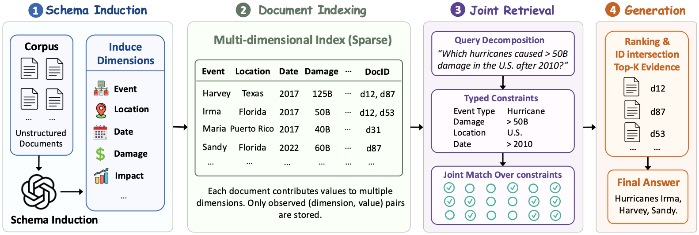
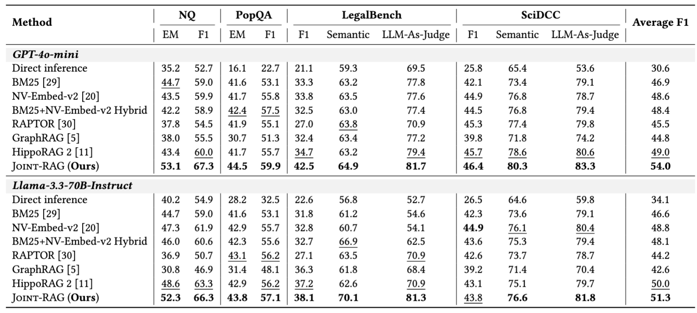

# Joint-RAG: Jointly Structured Multi-Dimensional Indexing for Retrieval-Augmented Generation

<div align="left">
<!--   -->
   
</div>

### Our Joint-RAG vs. Baselines
   


### 1. Organization

- `QA`: saves the question-answering pairs
- `corpus`: saves the original corpus
- `hypercube`: saves the constructed multi-dimensional index of Joint-RAG (one file per dimension, line-aligned with the passages)
- `baselines`: includes the reproduced methods where the official codes are not available. We run graph-based models included in our work using their official GitHub repository. 
- `evaluation`: computes evaluation scores
- `gpt_extraction`: extracts entities to construct the multi-dimensional index
- `utils`: helper functions
- `qa_norag.py`: script to run LLMs without retrieval
- `qa_rag_nq.py`: script to run Joint-RAG on the NQ dataset
- `qa_rag_popqa.py`: script to run Joint-RAG on the PopQA dataset
- `qa_rag_hurricane.py`: script to run Joint-RAG on the hurricane dataset
- `qa_rag_geography.py`: script to run Joint-RAG on the geography dataset
- `qa_rag_dam.py`: script to run Joint-RAG on the dam dataset
- `qa_rag_legalbench.py`: script to run Joint-RAG on the legalbench dataset


### 2. Environment
```
conda create --name joint-rag python==3.10
conda activate joint-rag

pip install -r requirements.txt
```

### 3. Run the framework
#### 3.0 Construct the multi-dimensional index

- If you want to run on our datasets, you can skip this step since we have constructed the index and saved it in the `hypercube` folder.

- If you want to use your own dataset, please first put the text corpus in `corpus` folder: `corpus/YOUR_DATA_FOLDER/YOUR_DATA_FILE`, then construct your own index by revising the entity extraction file in the `gpt_extraction` folder.

```
python gpt_extraction/joint_extract_xxx.py
```


#### 3.1 Run the direct inference without RAG baseline
```
export CUDA_VISIBLE_DEVICES=GPU_ID
export OPENAI_API_KEY="your OPENAI_API_KEY"
export TOGETHER_API_KEY="your TOGETHER_API_KEY"
```
In our work, we use multiple datasets `NQ`, `PopQA`, `LegalBench (law)`, `SciDCC (hurricane, geography, aging_dam)` with two LLMs, `gpt-4o-mini` and `Llama-3.3-70B-Instruct` (`--model llama3`, called via Together AI; set `TOGETHER_API_KEY`). If you want to save the QA results, set the following "save" to true; otherwise, false.
```
python qa_norag.py --data `DATASET` --model `MODEL_NAME` --save `true`
```


#### 3.2 Run Joint-RAG
All RAG methods retrieve the top-5 documents (`--k 5`, the default). `--model` can be `gpt-4o-mini` or `llama3` (Llama-3.3-70B-Instruct).

NQ:
```
python qa_rag_nq.py --data nq --model gpt-4o-mini --retrieval_method hypercube --k 5 \
    --hc_rank dense_tiebreak --fill --cells_from hypercube/nq/cells_v1.json \
    --gold QA/nq/gold_passage_ids.json --qa_format hipporag_norefusal2 --save true
```

PopQA:
```
python qa_rag_popqa.py --data popqa --model gpt-4o-mini --retrieval_method hypercube --k 5 --save true
```

LegalBench and SciDCC (e.g., hurricane):
```
python qa_rag_legalbench.py --data legalbench --model gpt-4o-mini --retrieval_method hypercube --k 5 --save true
python qa_rag_hurricane.py --data hurricane --model gpt-4o-mini --retrieval_method hypercube --k 5 --save true
```

Results are saved to `output/<data>/<model>/`. Entity embeddings are cached in `ent2emb/` on the first run.


### 4. Evaluation
We use automatic metrics (EM, F1, Semantic) and LLM-as-Judge to evaluate the answers. Both scripts accept `--data` in `nq`, `popqa`, `legalbench`, `hurricane`, `geography`, `aging_dam`, and read the output file saved by the QA scripts (`output/<data>/<model>/...`). Use `--input` to point to a specific output file, e.g., one saved with extra options such as the NQ command above.

#### 4.1 NLP metrics
EM and F1 are computed on normalized answers and take the maximum over all gold answers; Semantic is the cosine similarity of `all-MiniLM-L6-v2` embeddings.
```
python evaluation/nlp_metric.py --data popqa --model gpt-4o-mini --retrieval_method hypercube --k 5 --metric all
python evaluation/nlp_metric.py --data nq --model gpt-4o-mini \
    --input output/nq/gpt-4o-mini/llm_output_hypercube_k5_dense_tiebreak_fill_qahipporag_norefusal2_responses.json
```

#### 4.2 LLM-as-Judge
Three LLM judges, GPT-4o (`gpt-4o-2024-11-20`), GPT-5.2 (`gpt-5.2-2025-12-11`) and GPT-6.1 (`gpt-6.1-sol`), rate each answer on correctness and completeness (0 or 1 each). For each judge we compute the average correctness, and the reported LLM-as-Judge score is the mean over the three judges. Per-sample judgments are saved to `*_judged.json`; re-running the script reuses them, so an interrupted run can be resumed.
```
python evaluation/llm_as_judge.py --data legalbench --model gpt-4o-mini --retrieval_method hypercube --k 5
```
Use `--judges` to select a subset of judges (e.g., `--judges gpt-4o`) and `--workers` to set the number of concurrent API requests (default 8).


### 5. Results

#### QA and Retrieval Performance
<div align="left">
 
</div>


